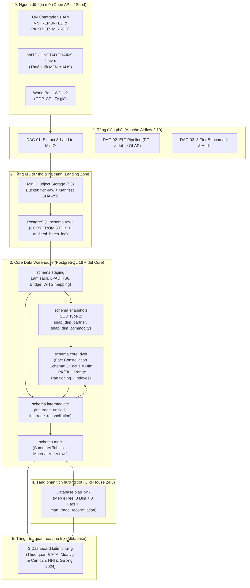

# Đặc tả kiến trúc Data Warehouse mã nguồn mở (`TLCN_DW_XNK`)

## 1. Triết lý thiết kế và kiến trúc tổng thể 5 tầng

Hệ thống được thiết kế theo mô hình **ELT hiện đại trên nền tảng 100% mã nguồn mở** (*Modern Open-Source Data Warehouse*), tách bạch rõ ràng trách nhiệm giữa từng tầng lưu trữ và xử lý:

### Luận giải lựa chọn kiến trúc ELT thay cho ETL đóng gói
1. **Tách rời lớp lưu trữ thô bất biến (*Immutable Raw Layer*):** Toàn bộ dữ liệu trích xuất được băm SHA-256 và lưu trên **MinIO** phân vùng theo `source=<name>/dt=<YYYY-MM-DD>/` trước khi nạp bằng `COPY FROM STDIN` vào `raw.*`. Nếu logic nghiệp vụ ở tầng dbt thay đổi, có thể tái xử lý hoàn toàn từ MinIO/Raw mà không cần gọi lại API nguồn.
2. **Transformation-as-Code với dbt Core:** Mọi biến đổi SQL được quản lý phiên bản bằng mã nguồn, tự động sinh đồ thị **Data Lineage** qua `dbt docs`, theo dõi lịch sử chiều thay đổi chậm **SCD Type 2** qua `dbt snapshot`, và chạy bộ kiểm định chất lượng dữ liệu tự động qua `dbt test`.
3. **Tránh bẫy Over-Engineering cho dữ liệu có cấu trúc vừa (~112k dòng):** Thay vì triển khai cụm Spark/Iceberg/Trino tiêu tốn nhiều GB RAM cho ~32 MB dữ liệu CSV có cấu trúc chặt chẽ, hệ thống dùng **PostgreSQL 16** (kèm PK/FK vật lý, Range Partitioning, Covering/BRIN Index và Materialized Views) làm Core Data Warehouse, kết hợp **ClickHouse 24.8** (*Columnar Engine*) để kiểm chứng hiệu năng thực nghiệm giữa kiến trúc lưu trữ hướng dòng (*Row-store*) và hướng cột (*Columnar*).

---

## 2. Thiết kế mô hình đa chiều Kimball (Fact Constellation / Galaxy Schema)

Data Warehouse sử dụng mô hình **Fact Constellation Schema (Galaxy Schema)** gồm **3 bảng Fact** có độ mịn khác nhau, liên kết thông qua **8 bảng Conformed Dimensions** và có ràng buộc `PRIMARY KEY` / `FOREIGN KEY` vật lý ([00_constraints.sql](../sql/postgres/00_constraints.sql)).

### 2.1. Ma trận Bus (Enterprise Bus Matrix)

| Quy trình nghiệp vụ (Business Process) | `dim_date` | `dim_partner` | `dim_commodity` | `dim_flow` | `dim_perspective` | `dim_tariff_type` | `dim_indicator` | `dim_audit` | Độ mịn (Grain) |
|---|:---:|:---:|:---:|:---:|:---:|:---:|:---:|:---:|---|
| **BP1: Giao dịch VN tự báo cáo** | Tháng | X | HS6 | X | `VN_REPORTED` | - | - | X | Tháng × Đối tác × HS6 × Luồng × Góc nhìn |
| **BP2: Giao dịch đối tác báo cáo (Mirror)** | Tháng | X | HS6 | X | `PARTNER_MIRROR` | - | - | X | Tháng × Đối tác × HS6 × Luồng × Góc nhìn |
| **BP3: Biểu thuế quan song phương** | Năm (`YYYY00`) | X | HS6 | - | - | X | - | X | Năm × Đối tác × HS6 × Loại thuế × Combo |
| **BP4: Chỉ số kinh tế vĩ mô** | Năm (`YYYY00`) | X | - | - | - | - | X | X | Năm × Quốc gia × Chỉ số |

### 2.2. Khai báo hợp đồng độ mịn (Grain Contracts)

- **`core_dwh.fact_trade` (`111,848` dòng):** Mỗi dòng biểu diễn tổng kim ngạch (`primary_value_usd`, `fob_value_usd`, `cif_value_usd`), khối lượng tịnh (`net_wgt_kg`) và số lượng (`qty`) trong **1 tháng** giữa Việt Nam và **1 đối tác**, cho **1 mã HS6 đã chuẩn hóa (*As-Mapped* HS2022)**, theo **1 luồng (`X`/`M`)**, dưới **1 góc nhìn (`1: VN_REPORTED` hoặc `2: PARTNER_MIRROR`)**. Khóa duy nhất trên grain: `(date_key, partner_key, commodity_key, flow_key, perspective_key)`.
- **`core_dwh.fact_tariff_rate` (`419` dòng):** Mỗi dòng biểu diễn thuế suất bình quân (`ad_valorem_pct`, tối thiểu/tối đa, số dòng thuế `total_lines`) áp dụng trong **1 năm** (khóa `YYYY00`) cho cặp **Việt Nam – Đối tác** theo `combo_code` (`VN_IMPORT_MFN`, `VN_IMPORT_PREF`, `MKT_EXPORT_MFN`, `ANCHOR`), **1 mã HS6**, **1 loại thuế (`MFN`/`PREF`)**.
- **`core_dwh.fact_macro_indicator` (`300` dòng):** Mỗi dòng biểu diễn giá trị của **1 chỉ số vĩ mô World Bank** tại **1 quốc gia** trong **1 năm** (`YYYY00`).

---

## 3. Năm giải pháp kiến trúc trọng tâm

### 3.1. Giải pháp đa độ mịn bằng Year Sentinel (`YYYY00`)
- Bảng `dim_date` chứa đồng thời 120 dòng độ mịn tháng (`201501`–`202412`, `granularity = 'MONTH'`) và 10 dòng mốc năm (`201500`–`202400`, `granularity = 'YEAR'`, `quarter = NULL`, `month = NULL`).
- Giải pháp này bảo toàn **100% toàn vẹn tham chiếu khóa ngoại** giữa các Fact năm (`fact_tariff_rate`, `fact_macro_indicator`) với `dim_date` mà không phải gán sai dữ liệu năm vào tháng 01 hay tháng 12.
- Rủi ro trộn độ mịn khi truy vấn được kiểm soát chặt bằng **Luật R5** và 3 bài test dbt tự động (`test_fact_trade_no_sentinel_date`, `test_fact_tariff_year_sentinel_only`, `test_fact_macro_year_sentinel_only`).

### 3.2. Xử lý biến động phân loại hàng hóa (`HS2017 -> HS2022`) theo nguyên tắc *As-Is* vs *As-Mapped*
- Năm 2022, WCO tách mã điện thoại di động `8517.12` (HS2017) sang `8517.13` (Smartphones, HS2022).
- Kho dữ liệu lưu song hành hai giá trị:
  - `dim_commodity.hs6` (**As-Mapped**): Chuẩn hóa thống nhất về `851713` qua bảng cầu nối `ref_hs_bridge` để phân tích chuỗi thời gian 10 năm liên tục.
  - `fact_trade.hs6_reported` (**As-Is**): Bảo toàn nguyên gốc `851712` trước năm 2022 để phục vụ kiểm toán và truy vết nguồn dữ liệu gốc.

### 3.3. Kiến trúc đa góc nhìn & hòa giải dữ liệu gương (Multi-Perspective Reconciliation)
- **Nguyên tắc chống cộng trùng (Luật R4):** `core_dwh.fact_trade` lưu tách biệt 2 góc nhìn qua `perspective_key` (`1: VN_REPORTED` = 98,596 dòng; `2: PARTNER_MIRROR` = 13,252 dòng). Tuyệt đối không chèn dòng `RECONCILED` vào bảng Fact gốc.
- **Tầng hòa giải tách biệt (`intermediate.int_trade_reconciliation` -> `mart.mart_trade_reconciliation`):**
  1. Thực hiện `FULL OUTER JOIN` giữa luồng VN (loại trừ dòng tổng hợp `World`) và luồng Mirror đảo chiều (`1 <-> 2`).
  2. Áp dụng hệ số quy đổi chi phí vận tải & bảo hiểm `CIF -> FOB` từ `ref_cif_fob_factor` theo nhóm hàng và tuyến hàng hải (`INTRA_ASIA`, `TRANS_PACIFIC`, `ASIA_EUROPE`, `UNKNOWN` mặc định `6.0%`):
     $$\text{Mirror}_{\text{FOB}} = \frac{\text{Mirror}_{\text{CIF}}}{1 + \text{factor\_pct} / 100}$$
  3. Gán cờ minh bạch nguồn gốc `data_source_flag` (`BOTH_AVAILABLE`, `VN_OFFICIAL_ONLY`, `MIRROR_ESTIMATED`, `NO_DATA`) và mức độ chênh lệch `discrepancy_level` (`LOW`, `MODERATE`, `HIGH`, `MISSING_VN_REPORTED`, `MISSING_MIRROR`).

### 3.4. Quản trị Hybrid SCD Type 2 & kiểm soát tính cộng gộp (Summarizability Governance)
- **Hybrid SCD Type 2:** Hai bảng chiều biến động chậm (`dim_partner` và `dim_commodity`) lưu toàn bộ lịch sử phiên bản (`dbt_valid_from`, `dbt_valid_to`, `dbt_scd_id`) tại `snapshots.snap_dim_partner` và `snapshots.snap_dim_commodity` bằng `dbt snapshot` (`strategy='check'`). Tầng phục vụ `core_dwh.dim_partner` / `core_dwh.dim_commodity` phơi bày các bản ghi hiện hành (`WHERE dbt_valid_to IS NULL`) kèm cột `valid_from`, `valid_to`, `is_current` để truy vấn hàng ngày luôn ngắn gọn và nối khóa mượt mà.
- **Summarizability Governance & kiểm định đối xứng (`dw_usage_rule` + `dbt test`):**
  - Phân loại rạch ròi độ đo **Additive** (`primary_value_usd`, `net_wgt_kg`) và **Non-additive** (`ad_valorem_pct` — bắt buộc tính bình quân gia quyền theo `total_lines`, cấm dùng `AVG` hoặc `SUM`, kiểm tra bằng *Weighted-Average Bounds Check*).
  - Khóa `SUM(qty)` chéo mã HS6 (Luật R1), loại trừ thực thể tổng hợp `World` (`is_aggregate = FALSE`) khi xếp hạng hoặc tính HHI (Luật R3).
  - Phủ kiểm định đối xứng 100% `not_null`, `relationships` (tất cả FK kể cả `tariff_type_key` và `audit_key`), và duy nhất grain (`test_fact_trade_grain_unique`, `test_fact_tariff_grain_unique`, `test_fact_macro_grain_unique`) trên cả 3 bảng Fact.
  - Hiện thực **Kimball Cross-Fact Drill-Across** kết nối `fact_trade` và `fact_macro_indicator` qua Conformed Dimensions (`dim_date`, `dim_partner`) tại `mart.mart_trade_macro_yearly` (`45` dòng) và truy vấn Q7 (`sql/postgres/03_olap_queries.sql`, `sql/clickhouse/01_olap_queries.sql`).

### 3.5. Tối ưu lưu trữ vật lý & công cụ phân tích hướng cột
1. **Ràng buộc toàn vẹn vật lý (`sql/postgres/00_constraints.sql`):** Tạo 11 `PRIMARY KEY` (8 Dim + 3 Fact) và 15 `FOREIGN KEY` trên `core_dwh` giúp DBeaver tự động dựng sơ đồ ERD đầy đủ.
2. **PostgreSQL Declarative Range Partitioning (`sql/postgres/01_partitioning_and_indexes.sql`):** Phân mảnh bảng `core_dwh.fact_trade_partitioned` theo `calendar_year` (`p2015`..`p2025` + `pdefault`), kèm unique grain index bao gồm khóa phân vùng, covering indexes (`INCLUDE`) và `BRIN` index cho cột `date_key`.
3. **PostgreSQL Materialized Views (`sql/postgres/02_materialized_views.sql`):** Xây dựng 4 Materialized Views tại schema `mart` (`mv_trade_summary`, `mv_trade_balance`, `mv_market_concentration`, `mv_trade_reconciliation`) có `UNIQUE INDEX` và được `dag_02` làm mới trực tiếp bằng `REFRESH MATERIALIZED VIEW CONCURRENTLY` mà không khóa luồng đọc.
4. **ClickHouse Columnar OLAP (`docker/clickhouse/init_olap.sql`):** Đồng bộ idempotent **đủ 8/8 Dimensions** (bao gồm `dim_audit`), 3 bảng Fact và `mart_trade_reconciliation` sang engine `MergeTree` (`PARTITION BY calendar_year`) để nén dữ liệu theo cột và phục vụ truy vấn tổng hợp đa chiều.
